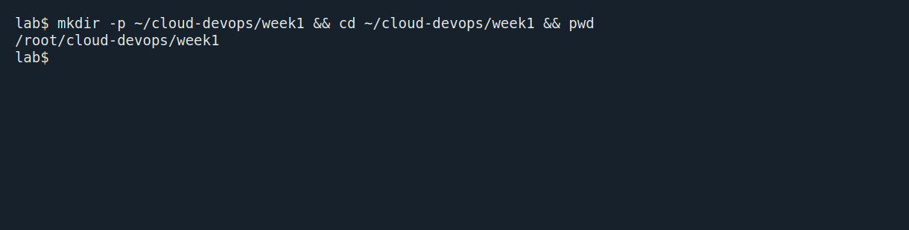
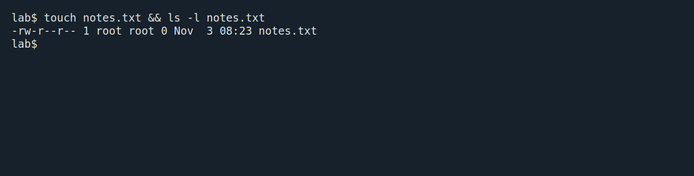
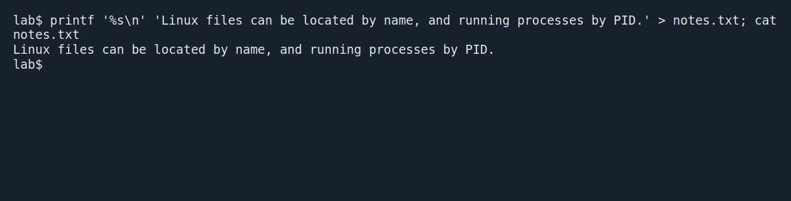
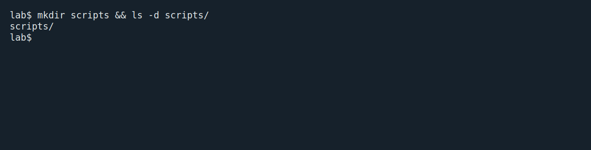
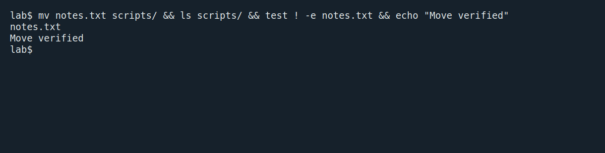
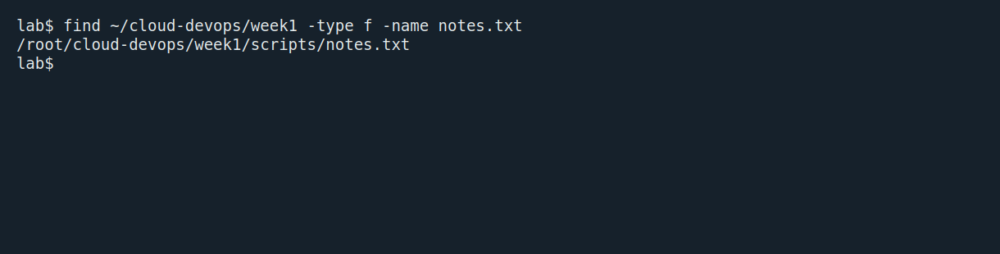
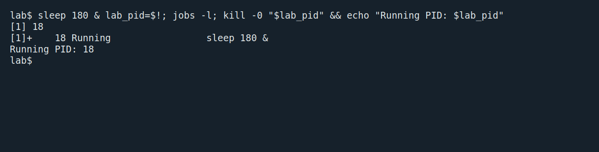

# Week 1 · Linux hands-on lab

Ahmed Yassin Ahmed · Group 2 · 3 November 2026

## 1. Create the workspace

```bash
mkdir -p ~/cloud-devops/week1 && cd ~/cloud-devops/week1 && pwd
```



## 2. Create an empty file

```bash
touch notes.txt && ls -l notes.txt
```



## 3. Write and read the note

```bash
printf '%s\n' 'Linux files can be located by name, and running processes by PID.' > notes.txt; cat notes.txt
```



## 4. Create the scripts directory

```bash
mkdir scripts && ls -d scripts/
```



## 5. Move the note

```bash
mv notes.txt scripts/ && ls scripts/ && test ! -e notes.txt && echo "Move verified"
```



## 6. Find the file by name

```bash
find ~/cloud-devops/week1 -type f -name notes.txt
```



## 7. Identify a running process

```bash
sleep 180 & lab_pid=$!; jobs -l; kill -0 "$lab_pid" && echo "Running PID: $lab_pid"
```



Each image captures the shell immediately after the command ran. The final job was stopped after its PID was verified. [Full shell transcript](evidence/linux-session.txt) · [Final note](scripts/notes.txt)
